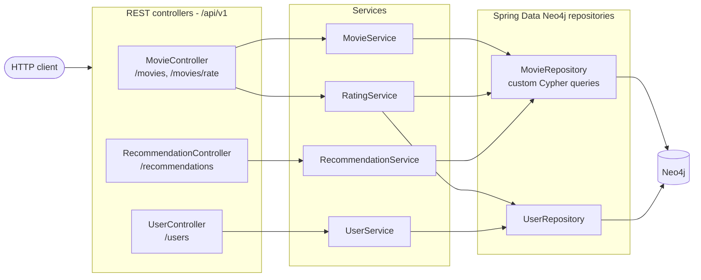
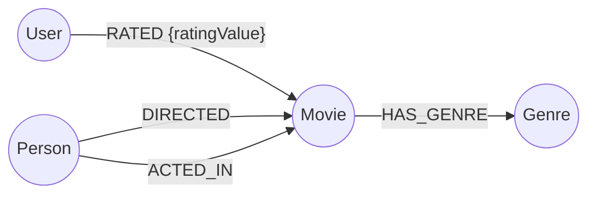

#  Movie Recommendation System (Spring + Neo4j)
[](https://github.com/AZapata27/movie-recommendation-system/actions/workflows/ci.yml) [](https://scorecard.dev/viewer/?uri=github.com/AZapata27/movie-recommendation-system)

A user-friendly and efficient platform that enables users to search movies, submit ratings, and receive personalized movie recommendations leveraging Neo4j graph database.

##  Project Description
This project implements a movie recommendation system powered by Neo4j, a graph database that efficiently manages complex relationships. By using similarity and clustering-based recommendation algorithms, the system delivers accurate and relevant movie recommendations tailored for each user.

##  Key Features
- **Dynamic Browsing**: Easy search for movies by title or genre.
- **User Management**: Enables users to rate movies.
- **Personalized Recommendations**: Intelligent recommendation algorithms based on user ratings and associations.
- **Intuitive Data Model**: Clearly defined models that ease integration with any frontend application.

##  Technology Stack
- **Java 21**
- **Spring Boot** – Main framework for agile, clean, and maintainable code.
- **Spring Data Neo4j** – Seamless integration and object-graph mapping.
- **Neo4j** – Powerful and flexible graph database for relationship management.
- **Lombok** – Reducing boilerplate Java code effectively.

## Architecture



Errors raised by the services (`NotFoundException`, `ConflictException`, `BadRequestException`) are translated to
RFC 7807 `ProblemDetail` responses (404 / 409 / 400) by `ExceptionControllerAdvice`.

### Graph model



## Testing

```sh
./gradlew build
```

- Unit tests for the services with Mockito-mocked repositories (validation, not-found/conflict paths, rating create/update, recommendation delegation).
- Web layer tests with `@WebMvcTest` for every controller, including the `ProblemDetail` error mapping.
- A Spring Modulith structure check.
- `MovieRecommendationSystemApplicationTests` boots the full context against a Neo4j Testcontainer; it is skipped automatically when no Docker daemon is available and runs in CI.

##  Project Structure
```
src/main/java/dev/azapata/movierecommendationsystem
├── recomendation
│   ├── controller
│   ├── exception
│   ├── model
│   │   ├── dto
│   │   ├── nodes
│   ├── repository
│   ├── service
```

## Getting Started (Quick guide)
**1. Clone the Repository**
``` sh
git clone https://github.com/AZapata27/movie-recommendation-system.git
cd movie-recommendation-system
```
**2. Run Docker Compose**
``` sh
docker compose up
```

**3. Start Spring Boot Application**
With Maven:
``` sh
./mvnw spring-boot:run
```
With Gradle:
``` sh
./gradlew bootRun
```

## Highlighted Queries and Methods:
-  **Find movie by title**
``` java
  Optional<Movie> findByTitle(String title);
```
-  **Movies ordered by popularity**
``` java
  List<Movie> findMoviesOrderedByVotes(String genre);
```
-  **Personalized movie recommendations**
``` java
  List<Movie> recommendMoviesForUser(String userName);
```


## Primary Data Model
### Main Entities
- `User`: Represents users interacting with the system.
- `Movie`: Movies with collection of attributes (directors, actors, genres).
- `Rating`: Represents voting done by the users with rating values.
- `Person`: Persons related to movies (actors, directors).
- `Genre`: Categories for grouping movies.


### Dynamic Relationships
The project supports dynamic relationships enabling flexible connections between users, movies, and other entities based on context at runtime.
Example using dynamic relationships:
``` java
@Relationship
private Map<String, Movie> interactions = new HashMap<>();
```
Usage:
``` java
user.getInteractions().put("WATCHED", new Movie("Inception", 2010));
user.getInteractions().put("LIKED", new Movie("Interstellar", 2014));
```
Neo4j will store these relationships dynamically:
``` cypher
(User)-[:WATCHED]->(:Movie {title:"Inception"})
(User)-[:LIKED]->(:Movie {title:"Interstellar"})
```


## Future Improvements
- Simple GUI/web application integration.
- Additional recommendation algorithms (popularity-based, favorite genres, shared attributes, etc.).
- Integration with external movie databases/services (IMDb, TMDb).
